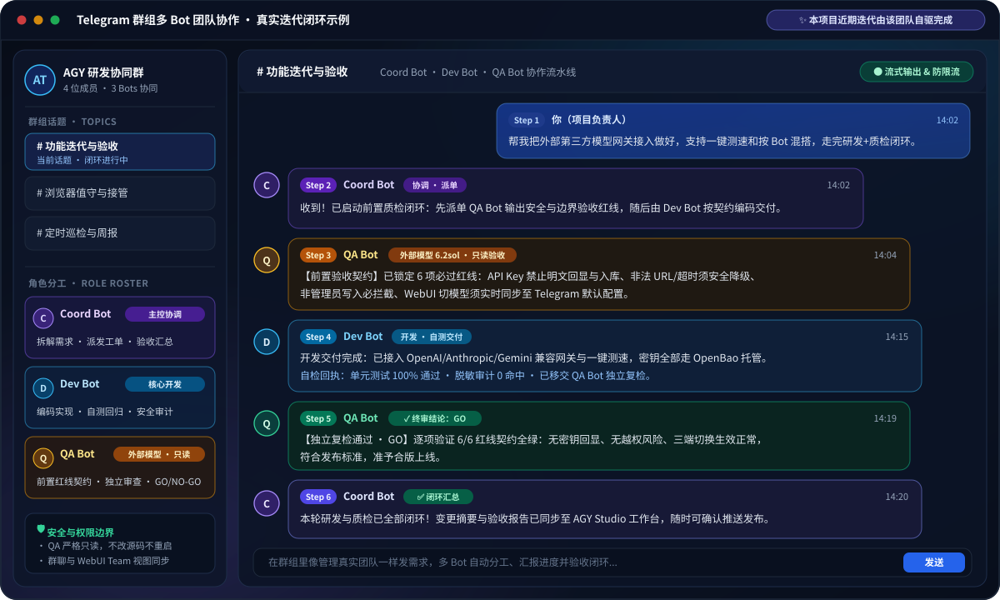
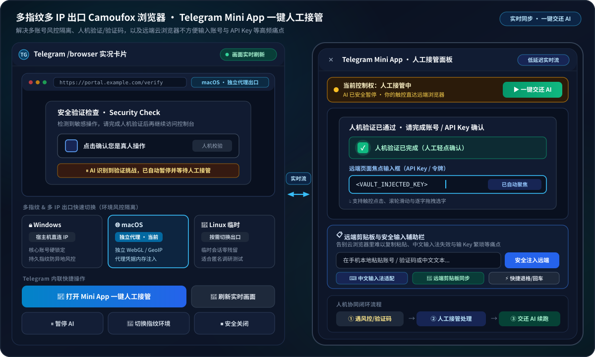
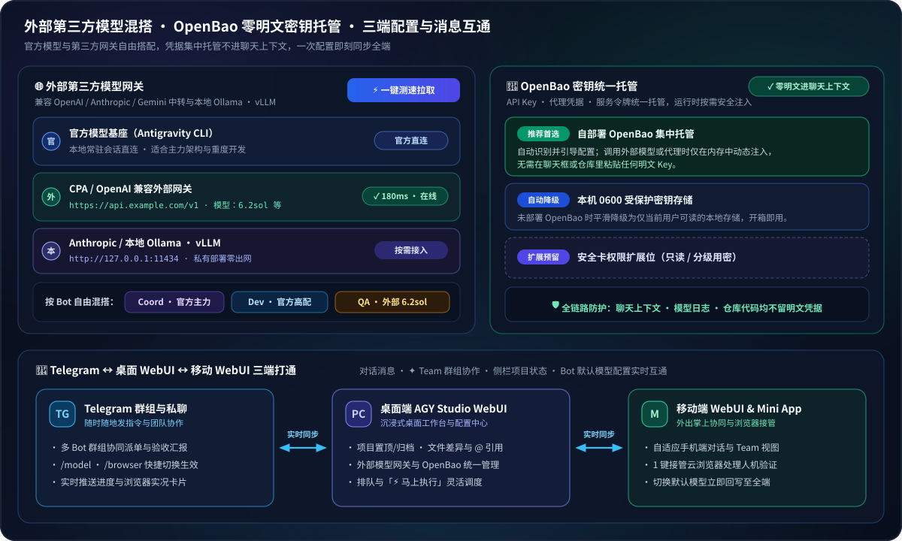
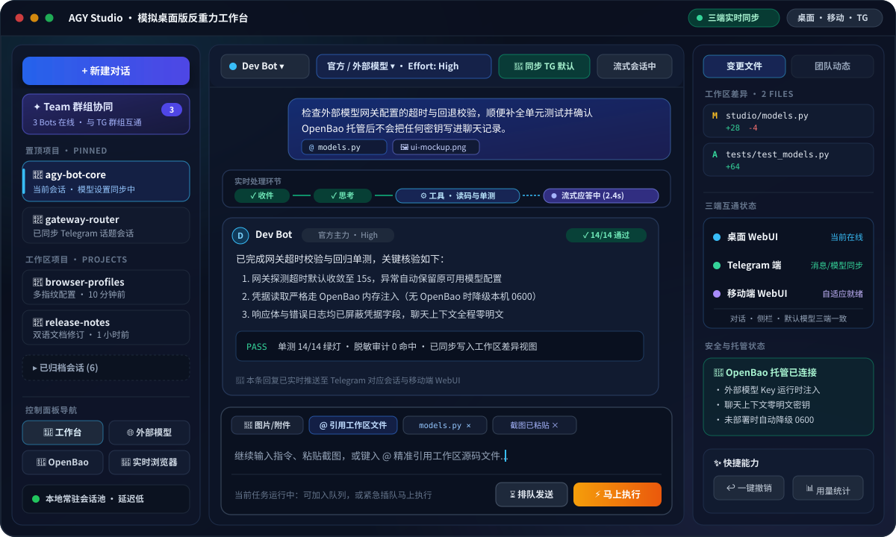

# agy-bot

[简体中文](./README.md) | **English**

An open-source AI collaborative workbench and multi-platform companion suite built natively on the **official Google Antigravity CLI (`agy`)**—connecting directly to local `agy` sessions without risky third-party reverse proxies, so you can orchestrate your AI engineering team seamlessly across **Telegram, Desktop WebUI, and Mobile WebUI**.

- **License**: [MIT](./LICENSE)
- **Repository**: [gaoshanyuhupo/agy-bot](https://github.com/gaoshanyuhupo/agy-bot)
- **Community**: [LINUX.DO](https://linux.do/)
- **Security & Contributing**: [SECURITY.md](./SECURITY.md) · [CONTRIBUTING.md](./CONTRIBUTING.md)

---

## Feature Highlights at a Glance

| Core Capability | Pain Point Solved |
| :--- | :--- |
| **1. Telegram Group Multi-Bot Team** | Upgrades single-bot chat into a multi-role team (Coordinator + Dev + Read-Only QA) with end-to-end dispatch, progress updates, and acceptance sign-off |
| **2. Multi-Fingerprint Browser & Mini App Takeover** | Isolates browser fingerprints and IP egress against anti-bot risk; 1-click pause & mobile takeover for CAPTCHAs, verifications, and pasting credentials into remote browsers |
| **3. Cross-Session Anti-Forgetting (Memory)** | Smooth post-compaction continuity, cross-session experience retrieval, and anti-poisoning guards (full capability built; long-term real-world tuning ongoing) |
| **4. Self-Hosted OpenBao Secret Custody** | Centralizes API keys, proxy credentials, and service tokens with on-demand injection—eliminating plaintext keys in chat context |
| **5. External Third-Party Model Gateways** | Mix official models with OpenAI / Anthropic / Gemini-compatible relays or local Ollama/vLLM, with 1-click latency probing and per-bot model selection |
| **6. Desktop-Style Workbench & 3-Platform Sync** | Desktop-grade AGY Studio WebUI synced in real time with Telegram and Mobile WebUI across chats, team views, sidebar state, and default bot models |

---

## Six Core Features

### 1. Telegram Group Multi-Bot Team Collaboration

Move beyond a single assistant doing everything unchecked. `agy-bot` lets you assemble a multi-role AI team inside one Telegram group or forum topic—such as a **Coordinator Bot** that scopes tasks and summarizes results, a **Dev Bot** that writes code and runs tests, and a **Read-Only QA Bot** that defines acceptance criteria up front and independently verifies every delivery.

- **Natural Group Workflow**: Drop a requirement in your group; the Coordinator dispatches structured tasks, tracks live progress, routes finished work to independent read-only QA, and closes the loop with a clear summary.
- **Clear Role & Permission Boundaries**: Supports admin vs. read-only isolation so QA bots stay strictly read-only without modifying source files or restarting live services.
- **Battle-Tested by Itself**: **Recent feature iterations and releases of this very project were collaboratively built, reviewed, and verified by this multi-bot team itself.**



---

### 2. Multi-Fingerprint, Multi-Egress Camoufox Browser + Telegram Mini App Human Takeover

When AI operates a remote cloud browser, the hardest friction points are rarely scripts—they are **account risk/fingerprint correlation, sudden CAPTCHA or human verification challenges, and how awkward it is to copy-paste accounts or API keys into a headless cloud browser**.

- **Multi-Fingerprint & Multi-IP Egress Isolation**: Built on Camoufox to maintain isolated browser profiles (Windows / macOS / Linux, viewport, locale, WebGL/GeoIP) with per-profile proxy egress or direct host IP switching. Lock your primary accounts to a persistent fingerprint and direct egress, while keeping temporary research sessions clean and ephemeral.
- **Live Telegram View & 1-Click Human Takeover**: Use `/browser` in Telegram to watch the live screen and switch profiles; whenever a verification challenge or login confirmation pops up, open the Telegram Mini App to pause AI with one tap and interact directly by touch.
- **Frictionless Remote Paste & Input**: Includes remote clipboard sync and a mobile CJK/IME input helper bar so you can safely inject accounts, codes, or keys into focused remote inputs—then **hand control back to AI with one click** to continue seamlessly from the updated page.

> Full operator and mobile guide: [docs/TELEGRAM_LIVE_BROWSER_GUIDE.md](./docs/TELEGRAM_LIVE_BROWSER_GUIDE.md).



---

### 3. Cross-Session Anti-Forgetting (Memory Management)

To tackle the classic pain of long conversations losing prior agreements or new sessions forgetting project context, `agy-bot` includes a built-in cross-session memory and anti-forgetting stack:

- **Smooth Post-Compaction Continuity**: After context compaction, key request timelines, recent dialogue context, and workspace file references are restored so work resumes without "amnesia."
- **Cross-Session Retrieval & Distillation**: Supports searching past decisions and solutions across sessions while distilling recurring patterns into reusable rules.
- **Anti-Poisoning Guardrails**: Protects long-term memory against untrusted external text and prompt injection attempts.

> **Candid Note**: The full cross-session memory management stack is already built and wired in; however, ever since spinning up the multi-bot group team we have been heads-down in high-intensity feature iteration, so its long-term real-world performance across broader daily scenarios is still being observed and refined. Community feedback is very welcome!

---

### 4. Self-Hosted OpenBao Centralized Secret Custody

A common security pitfall in AI-assisted engineering is pasting API keys, proxy passwords, or service tokens straight into chat—once inside conversation context, logs, or git history, leaks become hard to contain.

- **Zero Plaintext Keys in Chat Context**: Automatically detects and integrates with your self-hosted OpenBao vault to centralize API keys, proxy credentials, and service tokens, injecting them securely at runtime—**completely eliminating the risk of pasting plaintext keys into chat**.
- **Zero-Friction Local Fallback**: If OpenBao is not deployed on your host yet, `agy-bot` gracefully falls back to a user-private `0600`-protected local secret store so you can get started immediately.
- **Security Card Extension Slot**: Reserves a dedicated extension slot for fine-grained Security Card permissions (tiered read-only / read-write custody) when you are ready to scale up.

> Self-hosted setup and zero-trace secret workflow: [docs/OPENBAO_SECRETOPS_GUIDE.md](./docs/OPENBAO_SECRETOPS_GUIDE.md).

---

### 5. External Third-Party Model Support

Alongside official models, `agy-bot` now supports connecting external third-party model gateways so you can match each role and workload to the right model:

- **Broad Protocol Compatibility**: Works with mainstream OpenAI-, Anthropic-, and Gemini-compatible relays as well as self-hosted local Ollama or vLLM endpoints.
- **1-Click Probe & Model Discovery**: Configure your gateway and vaulted credentials in the WebUI "External Models" page to test connectivity/latency and fetch available models in one click.
- **Per-Bot Switching & Mixing**: Assign different models to different team roles freely—**for example, quality verification during this very feature upgrade was assisted by external models such as `6.2sol` connected through a CPA-compatible gateway**, combining independent review perspective with flexible cost control.



---

### 6. Desktop-Style Antigravity Workbench (AGY Studio WebUI) with 3-Platform Sync

Telegram is unbeatable for issuing tasks on the go, while deep code review, file referencing, and configuration management shine in a desktop-grade workspace. **AGY Studio WebUI** brings both together with seamless 3-platform synchronization:

- **Desktop-App Feel in Your Browser**: Clean three-column workbench featuring project management (pinning, archiving, new chats), a dedicated `✦ Team` group collaboration view, workspace file diff inspection, and built-in External Models & OpenBao management pages.
- **Multimodal Input & Smart Task Scheduling**: Drag-and-drop or paste screenshots/attachments, use `@` mentions to reference workspace files directly, watch real-time processing stages (Receive → Think → Tool Calls → Reply), and choose between **Queue** or **⚡ Run Now** priority execution while a turn is active.
- **True 3-Platform Continuity**: **Telegram, Desktop WebUI, and Mobile WebUI** stay continuously synchronized—chat messages, team collaboration activity, sidebar project states, and each bot's default model/effort settings propagate across all three surfaces automatically.



---

## Quickstart

> For a zero-guesswork single/multi-bot setup guide and Docker Compose instructions, see **[docs/AI-INSTALL.md](./docs/AI-INSTALL.md)** (ready to hand directly to your AI assistant).

### 1. Clone & Bootstrap the Telegram Bridge

```bash
git clone https://github.com/gaoshanyuhupo/agy-bot.git
cd agy-bot

python3 -m venv "$HOME/agy-tg-bridge/venv"
"$HOME/agy-tg-bridge/venv/bin/pip" install -e .

# Initialize runtime directory & chmod 0600 .env (never overwrites existing config)
"$HOME/agy-tg-bridge/venv/bin/agy-bot" setup --target-dir "$HOME/agy-tg-bridge"

# Run health diagnostics (add --fix for permissions, or --online to verify Telegram)
"$HOME/agy-tg-bridge/venv/bin/agy-bot" doctor --env-file "$HOME/agy-tg-bridge/.env"
```

<details>
<summary>Expand: Manual Bridge Copy & MCP / Systemd Templates</summary>

```bash
mkdir -p "$HOME/agy-tg-bridge"
cp bridge/bridge.py bridge/scheduler.py bridge/bot_bus.py bridge/bot_bus_mcp.py "$HOME/agy-tg-bridge/"
cp bridge/.env.example "$HOME/agy-tg-bridge/.env"
chmod 600 "$HOME/agy-tg-bridge/.env"
```

- MCP configuration template: [config/mcp_config.example.json](./config/mcp_config.example.json)
- Systemd service templates: [systemd/examples/](./systemd/examples) (including [`agy-studio.service.example`](./systemd/examples/agy-studio.service.example))

</details>

### 2. Launch AGY Studio WebUI (Desktop & Mobile Workbench)

```bash
# Install Studio backend dependencies and build the React WebUI bundle
python3 -m pip install -r studio/requirements.txt
(cd webui && npm ci && npm run build)

# Create an admin login account (credentials stored with chmod 0600 in ~/.config/agy-studio/users.json)
python3 -m studio.auth set-user --username admin --bot main --user-id 123456789 --role admin

# Start the local workbench server (listens on 127.0.0.1:18796 by default)
python3 -m studio.server
```

### 3. Docker / Compose Deployment (Optional)

Ready-to-use non-root container templates are included in [`Dockerfile`](./Dockerfile) and [`docker-compose.example.yml`](./docker-compose.example.yml) for single-bot or multi-bot team deployments.

### 4. Pre-Commit Desensitization Audit & Tests

```bash
# Strict desensitization and secret-leak check across workspace & Git history
python3 scripts/security_audit.py --mode public-release --check-history

# Run the automated test suite
python3 -m unittest discover -s tests -v
```

---

## Acknowledgements & Design References

`agy-bot` draws inspiration from and builds alongside several outstanding open-source projects:

- **Memory Management & Continuous Learning**:
  - [`thedotmack/claude-mem`](https://github.com/thedotmack/claude-mem) — Cross-session persistent memory and 3-step retrieval workflow
  - [`affaan-m/ECC`](https://github.com/affaan-m/ECC) — Atomic instinct observation, confidence scoring, and skill evolution concepts
  - [`NousResearch/hermes-agent`](https://github.com/NousResearch/hermes-agent) & [`HKUDS/nanobot`](https://github.com/HKUDS/nanobot) — Prefix-cache-friendly ruleset boundaries, background memory consolidation, and multi-agent collaboration ideas
- **Telegram Bridge, HITL & Engineering Practices**:
  - [`banteg/takopi`](https://github.com/banteg/takopi) — CLI setup/doctor onboarding experience, single-instance locking, and offline mock testing
  - [`overwirehq/claude-code-telegram`](https://github.com/overwirehq/claude-code-telegram) — Streaming reply boundaries and open-source security governance
  - [`grinev/opencode-telegram-bot`](https://github.com/grinev/opencode-telegram-bot) — Resilient Telegram code-block chunking and human-in-the-loop interaction ideas
  - [`openclaw/openclaw`](https://github.com/openclaw/openclaw) — Multimodal media routing and long-polling backoff resilience
  - [`chenhg5/cc-connect`](https://github.com/chenhg5/cc-connect) — Clean quickstart documentation structure, multi-channel bridging, and task scheduling references
  - [`emreturkmencom/antigravity-telegram-suite`](https://github.com/emreturkmencom/antigravity-telegram-suite) & [`pavel-molyanov/telegram-ai-agent`](https://github.com/pavel-molyanov/telegram-ai-agent) — Pioneering Antigravity / AI CLI Telegram bridge projects in the same ecosystem

---

## Community & Friendly Links

- **[LINUX.DO](https://linux.do/)** — Friendly community link for engineering discussions, AI workflows, and open-source sharing.

---

## Security, Contributing & License

- To report security issues responsibly, please follow [SECURITY.md](./SECURITY.md).
- Contributions are welcome! See [CONTRIBUTING.md](./CONTRIBUTING.md) before opening a pull request.
- Released under the [MIT License](./LICENSE).
