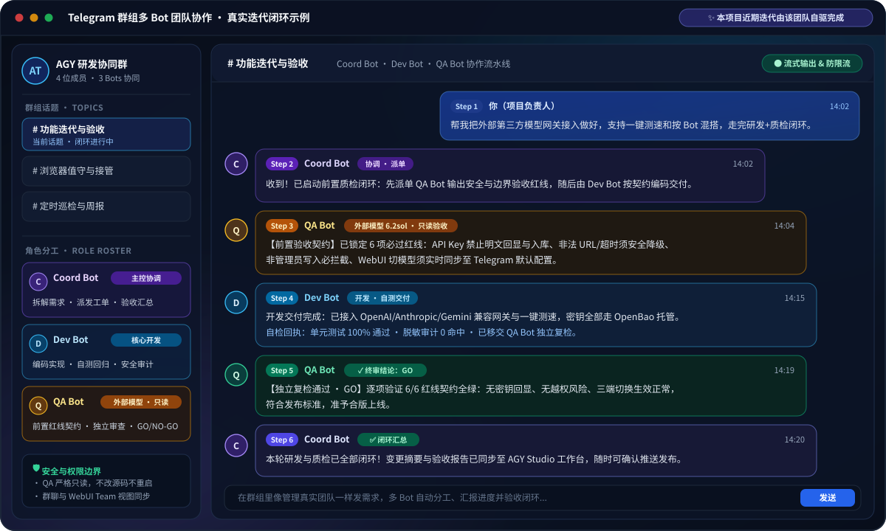
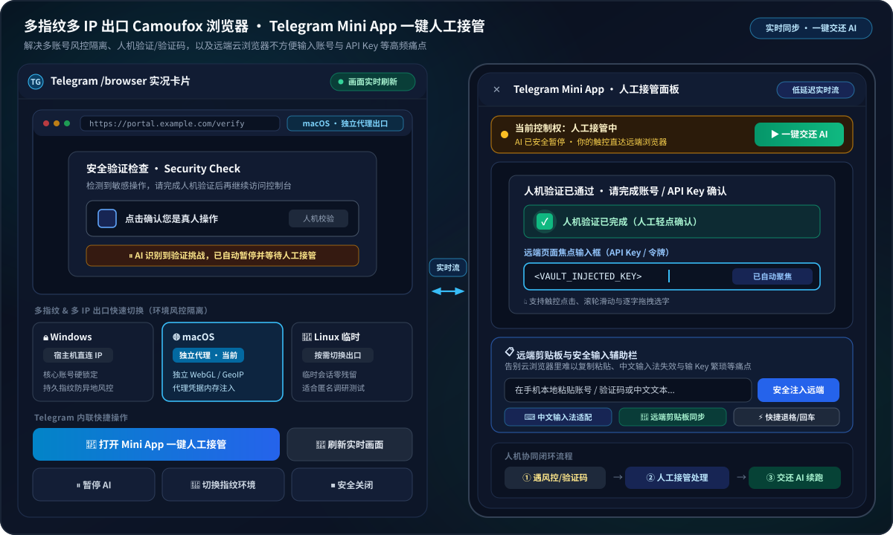
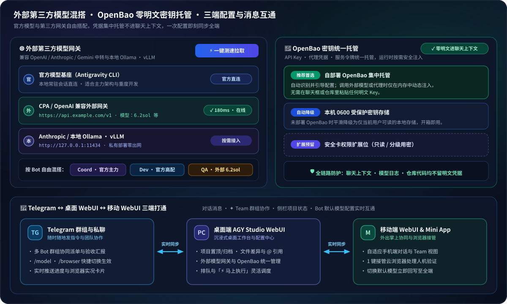
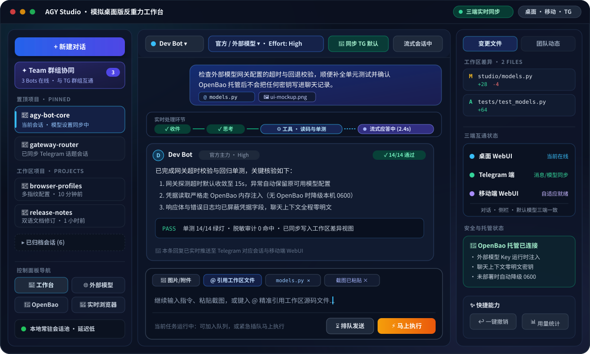

# agy-bot

**简体中文** | [English](./README.en.md)

基于官方 **Google Antigravity CLI (`agy`)** 原生构建的开源 AI 协作工作台与多端助手套件——直连本地官方 `agy` 会话，不走第三方反代链路，让你在 **Telegram、桌面 WebUI、移动 WebUI** 三端无缝指挥自己的 AI 工程团队。

- **开源协议**：[MIT](./LICENSE)
- **代码仓库**：[gaoshanyuhupo/agy-bot](https://github.com/gaoshanyuhupo/agy-bot)
- **社区交流**：[LINUX.DO](https://linux.do/)
- **安全与贡献**：[SECURITY.md](./SECURITY.md) · [CONTRIBUTING.md](./CONTRIBUTING.md)

---

## 核心能力一览

| 核心模块 | 解决什么痛点 |
| :--- | :--- |
| **1. Telegram 群组多 Bot 团队协作** | 把单人问答升级为「协调 + 开发 + 只读质检」多角色团队协同，派单、开发、验收在群里一站闭环 |
| **2. 多指纹多 IP 浏览器 + Mini App 人工接管** | 隔离账号环境防风控；遇到人机验证、验证码或远端输 Key/粘贴难题，手机一键暂停 AI 接管，处理完一键交还 |
| **3. 跨会话防遗忘（记忆管理）** | 长对话压缩后平滑衔接、跨会话经验检索与防投毒护栏（已搭建完整能力，持续观察打磨中） |
| **4. 自部署 OpenBao 密钥统一托管** | API Key、代理凭据集中托管按需注入，彻底告别把密钥明文贴进聊天上下文的风险 |
| **5. 外部第三方模型自由接入与混搭** | 除官方模型外，兼容主流 OpenAI / Anthropic / Gemini 中转与本地 Ollama/vLLM，一键测速、按 Bot 自由搭配 |
| **6. 模拟桌面版反重力工作台（三端互通）** | 贴近桌面 IDE 的 Web 工作台，与 Telegram、移动端 WebUI 实现消息、团队视图、侧栏状态与默认模型三端同步 |

---

## 六大核心功能

### 1. Telegram 群组多 Bot 团队协作

告别「一个机器人从头干到尾、自己写完自己吹」的单兵模式。`agy-bot` 支持在同一个 Telegram 群组或话题中组建多个各司其职的 AI Bot 角色——例如 **主控协调（Coordinator）** 负责拆解需求和派单汇总、**核心开发（Dev）** 负责改代码与跑测试、**只读质检（QA）** 负责先立验收红线并独立审查把关。

- **自然群聊协作**：你在群里提一个需求，协调 Bot 自动分工派单、实时播报进度，开发完成后移交只读 QA 独立审查，最终由协调 Bot 汇总结果形成闭环。
- **权限边界清晰**：支持群内管理员与只读角色隔离，质检 Bot 可严格锁定只读，不越权改动源码或重启线上服务。
- **真实自驱迭代**：**本项目近期的功能迭代与发布，正是靠这套多 Bot 团队自己协作开发并验收完成的。**



---

### 2. 多指纹多 IP 出口 Camoufox 浏览器 + Telegram Mini App 人工接管

用 AI 操作远端云浏览器时，最头疼的往往不是脚本怎么写，而是**账号风控关联、突然弹出的人机验证/验证码，以及在无头云浏览器里极不方便复制粘贴账号密码或 API Key**。

- **多指纹 + 多出口环境隔离**：基于 Camoufox 为不同任务维护独立的浏览器指纹环境（Windows / macOS / Linux、视口、时区、WebGL/GeoIP 等），并支持按配置自由切换独立代理出口或宿主机直连 IP；核心主力账号可硬锁定持久化指纹与直连出口，临时调研任务则用完即焚。
- **Telegram 实时查看与一键人工接管**：在 Telegram 中发送 `/browser` 即可看到实时画面与快捷切换按钮；遇到登录二次确认或验证码时，点开 Telegram Mini App 一键暂停 AI 进入人工接管，直接触控点击页面。
- **解决远端输入与粘贴痛点**：Mini App 内置远端剪贴板同步与移动端中文输入辅助栏，把手机上复制的账号、验证码或 Key 安全送入远端焦点输入框，处理完成后**一键交还 AI**，AI 会沿着当前页面状态无损继续执行。

> 详细配置与移动端使用指南见 [docs/TELEGRAM_LIVE_BROWSER_GUIDE.md](./docs/TELEGRAM_LIVE_BROWSER_GUIDE.md)。



---

### 3. 跨会话防遗忘（记忆管理）

针对长对话容易「聊着聊着忘了前面约定」、换一个会话就得把项目背景重新解释一遍的问题，项目内置了一整套跨会话记忆管理与防遗忘机制：

- **长对话压缩无损衔接**：触发上下文压缩后，自动还原关键指令时间线、近期对话脉络与文件读取索引，避免压缩后「失忆」。
- **跨会话经验检索与沉淀**：支持跨会话检索历史决策与已解决的问题，并将高价值习惯逐步整理为可复用规则。
- **防投毒与定期整理**：内置记忆安全守卫，过滤外部不可信文本中的恶意提示注入，避免污染长期记忆。

> **坦诚说明**：这套跨会话记忆管理能力目前已经完整搭建好，不过自从拉起多 Bot 群组后一直忙着高强度迭代开发，日常其它场景下的实际长期效果还在持续观察和打磨中，也欢迎社区一起试用反馈。

---

### 4. 接入自部署 OpenBao 密钥统一托管

用 AI 协助运维和开发时，最容易踩的安全坑就是把 API Key、代理账号或服务 Token 直接粘进聊天框——一旦进入对话上下文、日志或代码仓库，泄露风险极高。

- **OpenBao 统一托管，零明文进上下文**：支持自动识别并对接你自部署的 OpenBao 密钥库；外部模型 API Key、浏览器代理凭据与各类服务令牌统一集中管理，运行时按需在内存中安全注入，**彻底告别把 Key 明文贴进聊天上下文的风险**。
- **零门槛自动降级**：如果本机尚未部署 OpenBao，系统会自动平滑降级至当前用户私有、权限受保护的本机 `0600` 密钥存储，开箱即用不卡上手门槛。
- **预留安全卡扩展位**：控制面板已预留安全卡扩展入口，方便后续按需升级更细粒度的分级权限与只读/读写隔离策略。

> 自部署配置与无痕用密实战参考见 [docs/OPENBAO_SECRETOPS_GUIDE.md](./docs/OPENBAO_SECRETOPS_GUIDE.md)。

---

### 5. 支持接入外部第三方模型

除了原生直连官方模型外，`agy-bot` 现已全面支持接入外部第三方模型网关，让你可以按任务性价比与角色特长自由选型：

- **广泛协议兼容**：支持对接主流 OpenAI / Anthropic / Gemini 兼容中转网关，以及局域网或本机部署的 Ollama / vLLM 等私有模型服务。
- **一键测速与模型拉取**：在 WebUI 的「外部模型」管理页配置好网关与托管凭据后，可一键检测连通性与延迟并自动拉取可用模型列表。
- **按 Bot 自由切换与混搭**：不同角色的 Bot 可以分别绑定不同模型——**例如本次功能升级的质量检验环节，便是通过 CPA 兼容网关接入的 `6.2sol` 等外部模型协助完成的**，既保证了独立审查视角，也降低了高频验收成本。



---

### 6. 模拟桌面版的反重力工作台（AGY Studio WebUI），实现三端打通

在手机上用 Telegram 随时发指令很顺手，但在电脑前深度看代码、切项目、传文件、管配置时，一个像桌面应用一样顺手的工作台体验会好得多。**AGY Studio WebUI** 为此而生，并与 Telegram 深度打通：

- **桌面端交互体验**：提供三栏桌面工作台布局——左侧支持项目列表、置顶、归档、新建会话以及 `✦ Team` 群组协同视图；右侧可查看工作区变更与状态；内置外部模型与 OpenBao 可视化管理页。
- **顺手的多模态与任务调度**：支持直接拖入或粘贴图片/附件、键入 `@` 快速引用工作区文件；对话中实时呈现「收件 → 思考 → 工具调用 → 应答」处理环节；当上一条任务还在运行时，既可以按顺序**排队发送**，也能一键点击 **「⚡ 马上执行」** 紧急插队。
- **三端无缝互通**：**Telegram、桌面 WebUI、移动 WebUI** 全面打通——你在桌面工作台里切换某个 Bot 的默认模型或 Effort、发出的对话消息、群组 Team 协作动态以及侧栏项目状态，都会实时同步到 Telegram 与移动端，换设备接着干活零割裂感。



---

## 快速开始

> 完整的单 Bot / 多 Bot 一键初始化向导与 Docker Compose 编排说明，请参阅 **[docs/AI-INSTALL.md](./docs/AI-INSTALL.md)**（可直接交给你的 AI 助手按步骤引导安装）。

### 1. 克隆项目并初始化 Telegram 桥接

```bash
git clone https://github.com/gaoshanyuhupo/agy-bot.git
cd agy-bot

python3 -m venv "$HOME/agy-tg-bridge/venv"
"$HOME/agy-tg-bridge/venv/bin/pip" install -e .

# 一键初始化运行时目录与权限为 0600 的 .env（绝不覆盖已有配置）
"$HOME/agy-tg-bridge/venv/bin/agy-bot" setup --target-dir "$HOME/agy-tg-bridge"

# 运行环境体检（可追加 --fix 自动修复权限，或 --online 验证 Telegram 连通性）
"$HOME/agy-tg-bridge/venv/bin/agy-bot" doctor --env-file "$HOME/agy-tg-bridge/.env"
```

<details>
<summary>展开查看：手工复制运行文件与 MCP / Systemd 模板</summary>

```bash
mkdir -p "$HOME/agy-tg-bridge"
cp bridge/bridge.py bridge/scheduler.py bridge/bot_bus.py bridge/bot_bus_mcp.py "$HOME/agy-tg-bridge/"
cp bridge/.env.example "$HOME/agy-tg-bridge/.env"
chmod 600 "$HOME/agy-tg-bridge/.env"
```

- MCP 配置模板：[config/mcp_config.example.json](./config/mcp_config.example.json)
- Systemd 托管模板：[systemd/examples/](./systemd/examples)（含 [`agy-studio.service.example`](./systemd/examples/agy-studio.service.example)）

</details>

### 2. 启动 AGY Studio WebUI（桌面/移动工作台）

```bash
# 安装 Studio 后端依赖并构建前端页面
python3 -m pip install -r studio/requirements.txt
(cd webui && npm ci && npm run build)

# 创建管理员登录账号（密码安全保存在 ~/.config/agy-studio/users.json，权限 0600）
python3 -m studio.auth set-user --username admin --bot main --user-id 123456789 --role admin

# 启动本地工作台服务（默认监听 127.0.0.1:18796）
python3 -m studio.server
```

### 3. Docker / Compose 容器化部署（可选）

仓库提供开箱可用的非 root 容器构建模板 [`Dockerfile`](./Dockerfile) 与多 Bot 编排示例 [`docker-compose.example.yml`](./docker-compose.example.yml)，按需复制配置即可一键拉起。

### 4. 提交前安全自检与测试

```bash
# 严格脱敏与密钥防泄漏扫描
python3 scripts/security_audit.py --mode public-release --check-history

# 运行回归测试套件
python3 -m unittest discover -s tests -v
```

---

## 致谢与设计参考

`agy-bot` 的演进借鉴并致敬了以下优秀开源项目：

- **记忆管理与持续学习**：
  - [`thedotmack/claude-mem`](https://github.com/thedotmack/claude-mem) — 跨会话持久化记忆与三步检索思路
  - [`affaan-m/ECC`](https://github.com/affaan-m/ECC) — 原子级经验观察、置信度评分与技能演化架构
  - [`NousResearch/hermes-agent`](https://github.com/NousResearch/hermes-agent) & [`HKUDS/nanobot`](https://github.com/HKUDS/nanobot) — 提示词缓存友好边界、后台记忆整理与多 Agent 协作启发
- **Telegram 桥接、人机协同与工程实践**：
  - [`banteg/takopi`](https://github.com/banteg/takopi) — CLI 初始化与体检体验、单实例防冲突与离线测试范式
  - [`overwirehq/claude-code-telegram`](https://github.com/overwirehq/claude-code-telegram) — 流式回复体验与开源安全治理参考
  - [`grinev/opencode-telegram-bot`](https://github.com/grinev/opencode-telegram-bot) — Telegram 长消息代码块分片与人机确认交互启发
  - [`openclaw/openclaw`](https://github.com/openclaw/openclaw) — 多模态媒体消息处理与长轮询自愈实践
  - [`chenhg5/cc-connect`](https://github.com/chenhg5/cc-connect) — 轻量上手文档组织、多渠道桥接与定时任务参考
  - [`emreturkmencom/antigravity-telegram-suite`](https://github.com/emreturkmencom/antigravity-telegram-suite) & [`pavel-molyanov/telegram-ai-agent`](https://github.com/pavel-molyanov/telegram-ai-agent) — 同领域 Antigravity / AI CLI Telegram 桥接先驱项目

---

## 社区与友情链接

- **[LINUX.DO](https://linux.do/)** —— 友情社区入口，欢迎前往交流 AI 工程实践、自动化工具与开源项目心得。

---

## 安全策略、贡献与协议

- 发现安全问题请查阅 [SECURITY.md](./SECURITY.md) 按规范私密反馈。
- 欢迎通过 Issue / PR 参与改进，提交前请阅读 [CONTRIBUTING.md](./CONTRIBUTING.md)。
- 本项目基于 [MIT License](./LICENSE) 开源。
