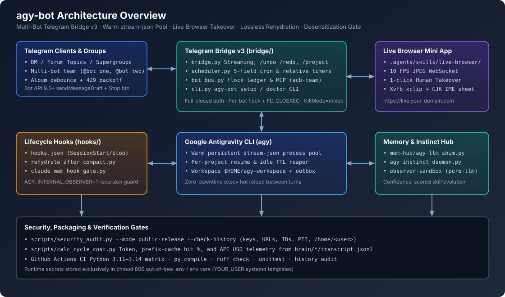

# agy-bot

[English](./README.md) | [简体中文](./README.zh-CN.md)

**Google Antigravity CLI (`agy`)** 开源配套生态栈：包含支持 Bot API 9.5+ `sendMessageDraft` 实时流式输出与群聊防 429 降级的多 Bot Telegram 桥接器、Telegram Mini App 实时浏览器接管与双向剪贴板中枢、`/compact` 后无损上下文重水合钩子、无状态本地观察者 LLM Shim、Continuous-Learning v2 习惯技能演化守护进程，以及全链路零泄漏脱敏门禁测试套件。

- **开源协议**：[MIT](./LICENSE)
- **代码仓库**：`https://github.com/gaoshanyuhupo/agy-bot`
- **社区交流**：[LINUX.DO](https://linux.do/)
- **安全策略**：[SECURITY.md](./SECURITY.md) · **贡献指南**：[CONTRIBUTING.md](./CONTRIBUTING.md)



---

## 核心架构与组件

### 1. `bridge/` — 多 Bot 实时 Telegram 桥接引擎 v3（`bridge.py`、`cli.py`）
- **原生 `sendMessageDraft` 流式渲染与群聊防 429 回退**：支持 `0ms` 瞬时 *"Thinking…"* 气泡、原生 Telegram 停止按钮、工具/思考状态事件驱动更新、动画流式输出，以及群聊自适应退避与最终消息合并投递。
- **常驻预热 `stream-json` 会话池**：维护 `agy --input-format stream-json --output-format stream-json` 预热子进程池，支持空闲 TTL 回收与即时中断取消。
- **项目与工作区切换（`/project`）**：在已注册的 Antigravity CLI 项目（`~/.gemini/config/projects/*.json`）间一键切换，并按会话域自动恢复对应对话。
- **订阅配额与本地开销账单（`/usage`、`/cost`）**：将云端配额实时查询（`/usage`）与本地 Transcript Token、Prefix Cache 命中率及 API USD 成本统计（`/cost`）清晰分离。
- **自主定时任务调度器（`/schedule` / `/cron`）**：支持标准 5 段式 Cron 表达式与中英文相对倒计时（`in 30m` / `10分钟`），内置最小安全间隔下限（300s）与 Telegram 内联控制面板。
- **内容寻址工作区撤销/重做（`/undo`、`/redo`）**：每轮自动采集工作区前后快照，支持外部修改冲突安全拦截、`force` 强行回滚与一键 Redo 重放。
- **多 Bot 并发与协作总线（`bot_bus.py`、`bot_bus_mcp.py`）**：独立实例 Outbox 隔离、`fcntl.flock` 原子图片认领锁 + 单实例 Poller 文件锁（`FD_CLOEXEC`），支持多 Bot（如 `@bot_one`、`@bot_two`）并发与 `acb-team` stdio MCP 委派。
- **安装引导与环境体检 CLI（`agy-bot setup` / `agy-bot doctor`）**：通过标准 `pyproject.toml` 提供 `agy-bot` 命令，一键引导部署与只读/联网体检。
- **零停机热重载**：通过哨兵文件（`AGY_TG_RELOAD_FILE`，如 `/tmp/agy_bridge_reload`）在空闲间隙自动执行优雅 `os.execv` 重载。

### 2. `.agents/skills/live-browser/` — Telegram 实时浏览器镜像与接管
- **双模实时视图**：群内单卡片 `editMessageMedia` 实况预览 + Telegram Mini App 低延迟二进制 JPEG WebSocket 流（基于 Cloudflare Tunnel 暴露 `https://live.your-domain.com`）。
- **三态控制权仲裁**：在 AI 观看、一键人工接管（通过 `ai_allowed_event` 暂停 AI 操作）与交还给 AI 之间无缝切换。
- **移动端/桌面端输入与 X11 剪贴板同步**：自动识别焦点输入框并弹出适配 `visualViewport` 的中文输入面板，支持外部 `xclip` 剪贴板读取与逐字拖拽选字（`document.caretPositionFromPoint`）。
- 完整操作与移动端指南见 [docs/TELEGRAM_LIVE_BROWSER_GUIDE.md](./docs/TELEGRAM_LIVE_BROWSER_GUIDE.md)。

### 3. `hooks/` — 无损压缩后重水合与生命周期门控
- **`rehydrate_after_compact.py`（`PreInvocation`）**：自动识别 `transcript_full.jsonl`（含 `/fork` 祖先链路）中的 `/compact` 检查点，精确恢复精简后的用户指令时间线、近期对话与按需 `read_file` 索引。
- **`claude_mem_hook_gate.py` 与 `hooks.json`**：统一生命周期门控（`SessionStart`、`PreInvocation`、`Stop`），通过 `AGY_INTERNAL_OBSERVER=1` 防止观察者递归，并跳过斜杠命令与零工具轻交互。

### 4. `mem-hub/` — 本地观察者 LLM Shim 与 Continuous-Learning v2
- **`agy_llm_shim.py`**：兼容 OpenAI/Anthropic 协议的本地 HTTP Shim，由无工具隔离的 `pure-llm` 沙盒驱动（`mem-hub/observer-sandbox/`），支持无状态轮转。
- **`agy_instinct_daemon.py`**：基于置信度提取会话经验（Instinct），维护 `.agents/rules/ecc-active-instincts.md` 并自动演化为受控上限的复用技能。

### 5. `scripts/` 与 `tests/` — 严格脱敏门禁与成本核算
- **`scripts/security_audit.py`**：零泄漏结构化扫描器，覆盖明文密钥/Token、半掩码前缀、含凭证 URL、非白名单外链与裸域名、长数字/Hex/UUID ID、个人邮箱与未登记 `@handle`、硬编码 `/home/<user>` 或 `User=` 路径、非文档 IP、高危运行态文件及 Git 全量提交历史（`--check-history`），支持外部黑名单文件（`--blocklist-file` / `~/.config/agy-audit-blocklist.txt`）。
- **`tests/`**：全离线 `unittest` 回归套件，覆盖脱敏门禁（`test_desensitization.py`）、P0 稳定性加固（`test_bridge_p0.py`）、核心引擎与撤销/相册/429（`test_bridge_core.py`）、定时调度（`test_scheduler.py`）、CLI 体检向导（`test_cli_doctor.py`）与多 Bot 总线（`test_bot_bus.py`、`test_group_chat_bus.py`）。
- **`scripts/calc_cycle_cost.py`**：独立命令行工具，解析 `~/.gemini/antigravity-cli/brain/*/logs/transcript.jsonl`，输出 Token 消耗、缓存命中率与估算 USD 节省。

---

## 目录结构

```text
agy-bot/
├── .agents/                  # 通用技能（live-browser、continuous-learning-v2、altare、mem-search）与工作流
├── .github/                  # CI 工作流、Issue 表单模板与 PR 脱敏自检清单
├── bridge/                   # Telegram Bridge v3（bridge.py、scheduler.py、bot_bus*.py、cli.py、.env.example）
├── config/                   # 脱敏后的 MCP 配置模板（mcp_config.example.json）
├── docs/                     # 系统架构图与 Live Browser / 移动端输入指南
├── hooks/                    # hooks.json、无损 rehydrate_after_compact.py 与生命周期门控
├── legacy/sdk-bridge/        # 早期 SDK bridge v1 历史参考
├── mem-hub/                  # agy_llm_shim.py、agy_instinct_daemon.py 与隔离 observer-sandbox/
├── scripts/                  # security_audit.py 脱敏审计器与 calc_cycle_cost.py 账单工具
├── systemd/examples/         # 通用 systemd 单元模板（KillMode=mixed + YOUR_USER 占位符）
├── tests/                    # 脱敏审计、桥接核心、调度器、CLI 向导与协作总线单测
├── workspace/                # 通用工作区 Agent 规范（AGENTS.md）
├── pyproject.toml            # PEP 621 包定义、`agy-bot` CLI 入口与 Ruff 门禁配置
├── README.md / README.zh-CN.md
├── SECURITY.md / CONTRIBUTING.md
└── LICENSE
```

---

## 快速上手

### 1. 克隆仓库、安装 CLI 并初始化运行目录

```bash
git clone https://github.com/gaoshanyuhupo/agy-bot.git
cd agy-bot

python3 -m venv "$HOME/agy-tg-bridge/venv"
"$HOME/agy-tg-bridge/venv/bin/pip" install -e .

# 一键初始化运行时目录与 .env（自动设置 chmod 0600；若未传 --force 绝不覆盖已有 .env）：
"$HOME/agy-tg-bridge/venv/bin/agy-bot" setup --target-dir "$HOME/agy-tg-bridge"
```

也可手工将 `bridge/*.py` 复制到 Git 工作区外目录并配置 `chmod 600` 的 `.env`：

```bash
mkdir -p "$HOME/agy-tg-bridge"
cp bridge/bridge.py bridge/scheduler.py bridge/bot_bus.py bridge/bot_bus_mcp.py "$HOME/agy-tg-bridge/"
cp bridge/.env.example "$HOME/agy-tg-bridge/.env"
chmod 600 "$HOME/agy-tg-bridge/.env"
# 编辑 $HOME/agy-tg-bridge/.env，填入 Telegram BotFather Token 与允许的 Chat ID
```

将 [config/mcp_config.example.json](./config/mcp_config.example.json) 复制到 `~/.gemini/antigravity-cli/mcp_config.json`，并将 `YOUR_USER` 与占位 Token 替换为本地实际值。

### 2. 运行环境体检与启动

```bash
# 默认离线只读体检（追加 --online 可联机校验 Telegram getMe 连通性）：
"$HOME/agy-tg-bridge/venv/bin/agy-bot" doctor --env-file "$HOME/agy-tg-bridge/.env"

# 前台试运行验证（生产环境建议使用第 3 步的 systemd 管理）：
# AGY_TG_ENV_FILE="$HOME/agy-tg-bridge/.env" "$HOME/agy-tg-bridge/venv/bin/python" "$HOME/agy-tg-bridge/bridge.py"
```

若启用 `.agents/skills/live-browser/`，请将 Tunnel Token 存放在仓库外的 `chmod 600` 文件中：

```bash
mkdir -p "$HOME/.config/agy-live-browser"
chmod 700 "$HOME/.config/agy-live-browser"
cat <<'EOF' > "$HOME/.config/agy-live-browser/tunnel.env"
CLOUDFLARE_TUNNEL_TOKEN=REPLACE_WITH_YOUR_TUNNEL_TOKEN
EOF
chmod 600 "$HOME/.config/agy-live-browser/tunnel.env"
```

### 3. Systemd 托管部署（可选）

通用服务模板位于 [`systemd/examples/`](./systemd/examples)，桥接服务均已配置 `KillMode=mixed`（支持平滑退出与后台子进程隔离）。部署前请将模板中的 `YOUR_USER` 替换为实际 Linux 用户名后安装到 `/etc/systemd/system/` 或 `~/.config/systemd/user/`。

### 4. 运行脱敏门禁、Lint 与单元测试

```bash
# 对工作区与全部 Git 历史执行严格公开级脱敏审计
python3 scripts/security_audit.py --mode public-release --check-history

# 代码 Lint 检查（可通过 pip install -e ".[dev]" 安装 ruff）
ruff check .

# 运行全量脱敏与核心功能单测
python3 -m unittest discover -s tests -v
```

---

## 致谢与设计参考

`agy-bot` 的架构设计与工程实践借鉴并致敬了以下优秀开源项目：

### 记忆管理与持续学习（Memory Management & Continuous Learning）
- [`thedotmack/claude-mem`](https://github.com/thedotmack/claude-mem)：跨会话持久化记忆与三步 `mem-search`（`search → timeline → get_observations`）检索架构；`hooks/claude_mem_hook_gate.py`、`hooks/hooks.json` 与 `mem-hub/agy_llm_shim.py` 面向其生命周期与观察者流水线实现了 `agy` 无递归适配。
- [`affaan-m/ECC`](https://github.com/affaan-m/ECC)（Everything Claude Code，及其引用的 *Homunculus* 架构思想）：`.agents/skills/continuous-learning-v2/`（`origin: ECC`）与 `mem-hub/agy_instinct_daemon.py` 借鉴了其原子级本能观察、置信度评分、项目作用域隔离与技能演化流程。
- [`NousResearch/hermes-agent`](https://github.com/NousResearch/hermes-agent) 与 [`HKUDS/nanobot`](https://github.com/HKUDS/nanobot)：借鉴了 Prefix Cache 友好的冻结规则集边界纪律（避免动态注入破坏提示词前缀缓存）、按需触发与后台记忆整合思路，以及多 Agent 协作工作区隔离设计。

### Telegram 桥接、人机协同与工程运维（Telegram Bridge, HITL & Ops）
- [`banteg/takopi`](https://github.com/banteg/takopi)：单实例 `flock` 防 `409` 冲突、`pyproject.toml` + `setup`/`doctor` CLI 向导、Mock Telegram 离线单测模式及 Python 3.11–3.14 + `ruff` CI 矩阵设计。
- [`overwirehq/claude-code-telegram`](https://github.com/overwirehq/claude-code-telegram)：`sendMessageDraft` 流式边界对照、`SECURITY.md` 与社区安全治理规范思路。
- [`grinev/opencode-telegram-bot`](https://github.com/grinev/opencode-telegram-bot)：Telegram HTML 分片重封代码块健壮性与人机工具审批 UI 规划参考。
- [`openclaw/openclaw`](https://github.com/openclaw/openclaw)：视频/贴纸/媒体组多模态路由及长轮询退避自愈纪律。
- [`chenhg5/cc-connect`](https://github.com/chenhg5/cc-connect)：轻量快速入门文档组织、多渠道桥接思路与按需任务调度参考。
- [`emreturkmencom/antigravity-telegram-suite`](https://github.com/emreturkmencom/antigravity-telegram-suite) 与 [`pavel-molyanov/telegram-ai-agent`](https://github.com/pavel-molyanov/telegram-ai-agent)：同领域 Antigravity / AI CLI Telegram 桥接先驱项目对照启发。

---

## 社区与友情链接

- **[LINUX.DO](https://linux.do/)** —— 友情社区入口，欢迎前往交流技术实践、工程经验与开源工具心得。

