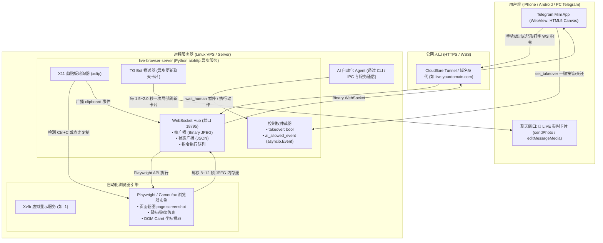

# Telegram 实时网页监控、人工接管与跨系统剪贴板完整实现指南

> **适用场景**：当使用 AI Agent（如 Claude / Gemini / 自定义 LLM Agent）通过 Playwright / Puppeteer / Camoufox 在远程服务器操作浏览器时，用户需要在 **手机或电脑端 Telegram** 中：
> 1. **同屏实时观看** 远程浏览器的渲染画面（高帧率 8~12 FPS）；
> 2. **人工接管控制**：遇到验证码、两步验证、扫码、支付或关键决策时，一键暂停 AI 并直接在 Telegram 内点击、滚动、打字；
> 3. **跨系统精准复制粘贴**：把远程虚拟浏览器中的任意字词、段落自由提取并写入手机系统剪贴板、苹果备忘录（Notes）、记事本或 Telegram 聊天。

---

## 目录
1. [系统整体架构与数据流](#1-系统整体架构与数据流)
2. [核心机制一：双模实时画面传输 (Live Card + Mini App)](#2-核心机制一双模实时画面传输-live-card--mini-app)
3. [核心机制二：三态人工接管与控制权仲裁 (Watch / Takeover / Resume)](#3-核心机制二三态人工接管与控制权仲裁-watch--takeover--resume)
4. [核心机制三：移动端触控打字与输入法弹窗 (Visual Viewport 适配)](#4-核心机制三移动端触控打字与输入法弹窗-visual-viewport-适配)
5. [核心机制四：跨系统双向复制粘贴 (Freeform Drag & Caret Selection)](#5-核心机制四跨系统双向复制粘贴-freeform-drag--caret-selection)
6. [核心机制五：安全鉴权 (Telegram WebApp HMAC-SHA256)](#6-核心机制五安全鉴权-telegram-webapp-hmac-sha256)
7. [完整实现源码 (可直接复制落地)](#7-完整实现源码-可直接复制落地)
   - [7.1 后端服务：live_browser_server.py](#71-后端服务-live_browser_serverpy)
   - [7.2 前端面板：static/index.html](#72-前端面板-staticindexhtml)
   - [7.3 Telegram Bot 桥接逻辑](#73-telegram-bot-桥接逻辑)
   - [7.4 公网穿透与 Systemd 服务配置](#74-公网穿透与-systemd-服务配置)
8. [调试验证步骤与避坑指南](#8-调试验证步骤与避坑指南)

---

## 1. 系统整体架构与数据流

整个系统由 **5 个核心组件** 组成：



---

## 2. 核心机制一：双模实时画面传输 (Live Card + Mini App)

### 2.1 为什么采用「双模」？
- **聊天内静态/动态 Live 卡片 (`editMessageMedia`)**：
  用户不需要时刻打开面板，留在 Telegram 正常聊天窗口中，就能看到一张每 1.5~2.0 秒更新一次的最新网页截图，附带当前标题、URL、AI 状态与接管按钮。
- **Mini App 高帧率全交互面板 (8~12 FPS)**：
  点击卡片底部的 `[🖥 打开实时画面 / 人工接管]` 按钮，直接在 Telegram 弹出的 Mini App 网页中以毫秒级延迟查看画面并进行实时操作。

### 2.2 为什么用 Binary JPEG WebSocket，而不是 WebRTC / H.264？
1. **零推流延迟**：WebRTC 建立连接（STUN/TURN/SDP）慢，而 WebSocket 握手瞬间完成（<100ms）；
2. **轻量与高兼容**：iOS Telegram WebView 对 WebRTC 硬件解码经常有后台冻结或比例缩放失真问题，而 HTML5 `<canvas>` 通过 `createImageBitmap(blob)` 渲染二进制 JPEG 可以在全平台达到稳态 10~15 FPS，CPU 占用极低；
3. **自适应跳帧防堆积**：当网络卡顿或客户端渲染变慢时，服务端检查写缓冲区大小（`transport.get_write_buffer_size() > 512KB`），如果堆积则主动丢弃旧帧，保证用户看到的永远是**最新画面**，杜绝延时累加。

---

## 3. 核心机制二：三态人工接管与控制权仲裁 (Watch / Takeover / Resume)

### 3.1 状态转移逻辑
系统定义了 3 种控制模式：
1. **`👀 观看模式 (Watch)`**：
   - AI Agent 独占浏览器操作权限；
   - 用户在 Mini App 内触控仅做**画面缩放 (Pinch-to-zoom)** 和 **双指拖动画布 (Pan)**，点击不会传递给远程网页，绝不打扰 AI 操作；
2. **`🖐 人工接管 (Takeover)`**：
   - 用户在 Mini App 点击 **`🖐 一键接管`**（或 AI 遇到验证码调用 `wait-human`）；
   - 服务端设置 `self.takeover = True` 并清空 `self.ai_allowed_event.clear()`；
   - AI 任务在后台被阻塞挂起（`await ai_allowed_event.wait()`），不会超时报错；
   - 网页所有触控、点击、滚动、打字全部转由用户接管；
3. **`▶️ 交还给 AI (Resume)`**：
   - 用户在面板完成验证码或手动操作后，点击顶部绿色的 **`▶️ 交还给 AI`**；
   - 服务端设置 `self.takeover = False` 并触发 `self.ai_allowed_event.set()`；
   - AI Agent 立即被唤醒，基于人工处理后的最新 DOM 状态继续向下执行。

### 3.2 坐标换算算法
客户端 Canvas 显示尺寸与远程浏览器实际视口（Viewport, 如 `1280x800`）存在缩放比例。客户端将点击位置精确归一化后转换：

```javascript
function clientToRemoteCoords(clientX, clientY) {
  const rect = screenCanvas.getBoundingClientRect();
  if (!rect.width || !rect.height) return null;
  // 计算在 Canvas 显示区域内的百分比 (0.0 ~ 1.0)
  const rx = (clientX - rect.left) / rect.width;
  const ry = (clientY - rect.top) / rect.height;
  if (rx < 0 || rx > 1 || ry < 0 || ry > 1) return null;
  // 映射到远程浏览器的真实分辨率
  return {
    x: Math.round(rx * (state.vw || 1280) * 10) / 10,
    y: Math.round(ry * (state.vh || 800) * 10) / 10,
    localX: rx * screenCanvas.clientWidth,
    localY: ry * screenCanvas.clientHeight
  };
}
```

---

## 4. 核心机制三：移动端触控打字与输入法弹窗 (Visual Viewport 适配)

### 4.1 传统方案在手机上的致命缺陷
直接在 Canvas 上点输入框时：
- iOS Safari / Telegram 内置浏览器不会主动弹出软键盘；
- 如果底部放一个固定输入框，软键盘弹起时会把网页顶飞、遮挡正在输入的区域，或者触发 iOS Safari 的 `100vh` 错位 Bug。

### 4.2 本方案的完整解法：顶部自适应 Smart Input Sheet
1. **远程焦点探测 (DOM Focus Inspection)**：
   每次用户在接管模式下点击页面，服务端在 Playwright 中执行轻量评估：
   ```javascript
   const el = document.activeElement;
   const tag = (el.tagName || '').toUpperCase();
   const editable = el.isContentEditable || tag === 'TEXTAREA' || 
     (tag === 'INPUT' && !['button','checkbox','radio','submit'].includes(el.type));
   if (editable) {
     return {
       label: el.placeholder || el.getAttribute('aria-label') || el.name || tag,
       value: el.type === 'password' ? '' : String(el.value || ''),
       isPassword: el.type === 'password'
     };
   }
   ```
2. **顶置浮窗 (`#kb-sheet`)**：
   检测到焦点后，服务端下发 `{"type": "input_focused", ...}`，前端在**屏幕顶部**（`position: fixed; top: 8px; left: 8px; right: 8px;`）弹出半透明输入面板。
   - 永远位于屏幕上半部分，**绝对不会被下方的手机软键盘遮挡**！
   - 支持显示当前输入框标签（如「请输入密码」、「验证码」）；
3. **输入法中文与特殊字符注入 (`insert_text`)**：
   - 避免使用逐键按下的 `page.keyboard.type`（容易丢中文拼音首字母或被 IME 拦截）；
   - 使用 Playwright 的 `page.keyboard.insert_text(text)`，支持完整中文、Emoji 及任意 Unicode 字符；
   - 按钮提供：`[填入并回车 ↵]`、`[仅填入]`、`[覆盖原内容 (先 Ctrl+A + Backspace)]`。

---

## 5. 核心机制四：跨系统双向复制粘贴 (Freeform Drag & Caret Selection)

这是远程沙箱浏览器与本地手机/电脑交互中最具挑战性的环节：**远程网页上的文字，怎样才能自由选择并复制到本地手机的剪贴板或苹果备忘录？**

本系统提供了 **4 条互为补充的链路**：

### 5.1 链路 A：手指画面涂抹选字 (`document.caretPositionFromPoint`)
用户只要在面板上点击 **`[🖊 选字]`** 按钮，就能像在纸上用荧光笔一样，手指划过想复制的那几个字：
1. **前端**：记录手指滑动的起点 `(x1, y1)` 和终点 `(x2, y2)`，并在画面上绘制半透明蓝色选框和顶部实时预览气泡（`#live-sel-pill`）；
2. **服务端**：在远程网页中解析这两个坐标对应的文字光标位置。
   > [!IMPORTANT]
   > Firefox / Camoufox (Gecko 内核) 使用 `document.caretPositionFromPoint(x, y)`；  
   > Chrome / Chromium (Blink 内核) 使用 `document.caretRangeFromPoint(x, y)`。  
   > 必须做跨内核兼容！
3. **精确 Range 构造与排序**：
   ```javascript
   function getCaret(x, y) {
     if (document.caretPositionFromPoint) {
       const p = document.caretPositionFromPoint(x, y);
       if (p && p.offsetNode) return { node: p.offsetNode, offset: p.offset };
     }
     if (document.caretRangeFromPoint) {
       const r = document.caretRangeFromPoint(x, y);
       if (r && r.startContainer) return { node: r.startContainer, offset: r.startOffset };
     }
     return null;
   }
   const c1 = getCaret(x1, y1);
   const c2 = getCaret(x2, y2);
   if (!c1 || !c2) return null;

   // 关键点：判断光标前后顺序（支持从左往右划，也支持从右往左反向划）
   const range = document.createRange();
   let forward = true;
   if (c1.node === c2.node) {
     forward = c1.offset <= c2.offset;
   } else {
     const cmp = c1.node.compareDocumentPosition(c2.node);
     forward = !!(cmp & Node.DOCUMENT_POSITION_FOLLOWING);
   }

   if (forward) {
     range.setStart(c1.node, c1.offset);
     range.setEnd(c2.node, c2.offset);
   } else {
     range.setStart(c2.node, c2.offset);
     range.setEnd(c1.node, c1.offset);
   }

   const sel = window.getSelection();
   sel.removeAllRanges();
   sel.addRange(range);
   return sel.toString().trim();
   ```
4. 手指一松开，服务端立即把选中的纯文本打包发回前端。

### 5.2 链路 B：单点轻触与防误抓保护 (`mode="point"`)
如果用户只是轻点某一段落或代码块：
- 优先提取 `<a>` 链接或 `<code>` / `<pre>` 代码块；
- **防误抓大容器保护 (Container Guard)**：若用户点到了段落之间的空白缝隙，`elementFromPoint` 可能会抓到巨大的 `<div>` 或 `<body>`。系统通过计算周围 60px 内最近的叶子元素（`<p>`, `<h1>`~`<h6>`, `<li>`, `<td>`），只提取该段落文字，防止一不小心复制整页。

### 5.3 链路 C：零指纹 X11 系统剪贴板监听 (`xclip`)
当网页上有「一键复制」按钮（例如 GitHub 的 Clone 命令、网站 API Key 复制按钮），或者用户在实体键盘上按下了 `Ctrl+C` 时：
- 服务端以 ~450ms 间隔在后台异步轮询 Xvfb 虚拟显示的剪贴板：
  ```bash
  xclip -o -selection clipboard -t UTF8_STRING
  ```
- 一旦检测到内容变化，立即主动向 Telegram Mini App 推送 `clipboard` 事件，自动弹窗显示。
- **优势**：不需要向目标网页注入任何破坏页面环境或对抗风控检测的 JavaScript 钩子函数（Zero JS Tampering）。

### 5.4 链路 D：客户端多目标交付与二次精确光标圈选 (`#clip-sheet`)
弹出的剪贴板浮窗包含：
1. **二次自由圈选与失焦锁定 (Blur-Safe Slice)**：
   用户可在预览文本框中长按，使用手机系统自带的蓝色光标圈选任意几个字。监听 `selectionchange` 事件，底部的复制按钮会自动变为：
   **`[✂️ 仅复制选中的 7 个字]`**！
2. **双通道安全写剪贴板**：
   由于部分移动端 WebView 对 `navigator.clipboard.writeText()` 有异步调用栈安全限制，采用**双通道兜底**：
   ```javascript
   function writeSystemClipboardSyncAndAsync(text) {
     let ok = false;
     try {
       const tmp = document.createElement('textarea');
       tmp.value = text;
       tmp.setAttribute('readonly', '');
       tmp.style.position = 'fixed';
       tmp.style.top = '-9999px';
       document.body.appendChild(tmp);
       tmp.focus();
       tmp.select();
       ok = document.execCommand('copy');
       document.body.removeChild(tmp);
     } catch (_) {}

     if (navigator.clipboard && navigator.clipboard.writeText) {
       navigator.clipboard.writeText(text).catch(() => {});
       ok = true;
     }
     return ok;
   }
   ```
3. **直达备忘录 (`navigator.share`)**：
   点击 `[📤 备忘录/分享]` 按钮，调用手机系统级 Share Sheet，用户可一键存入 **Apple Notes（苹果备忘录）**、微信文件传输助手、Google Keep 等；
4. **存为 `.txt` 文件**：
   桌面端或不支持分享的设备，直接本地生成 `.txt` 文本文件下载；
5. **发回 Telegram**：
   点击 `[📨 发回TG]`，通过 Bot 直接把提取到的文本作为聊天消息发到对话中。

---

## 6. 核心机制五：安全鉴权 (Telegram WebApp HMAC-SHA256)

由于该面板开放了对服务器虚拟浏览器的完全交互控制权，必须防止任何未授权的外部扫描和访问。

### 6.1 校验流程
1. Telegram 客户端在打开 Mini App 时，会在 URL Hash 或 `Telegram.WebApp.initData` 中注入加密签名字符串；
2. 服务端使用 Telegram Bot Token 进行 **HMAC-SHA256** 验证：
   - 秘钥生成：`secret_key = HMAC_SHA256("WebAppData", bot_token)`
   - 待签串：将 `initData` 中除 `hash` 外的所有字段按字母顺序排序，用换行符 `\n` 拼接成 `key=value`；
   - 签名计算：`calculated_hash = HMAC_SHA256(secret_key, data_check_string)`
3. 检查时间戳：验证 `auth_date` 是否在 24 小时有效期内；
4. **账号白名单校验**：解析出来的 `user.id` 必须严格在允许的 Telegram Chat ID 白名单内。
5. 非法请求一律直接返回 `403 Forbidden` 并切断 WebSocket。

---

## 7. 完整实现源码 (可直接复制落地)

### 7.1 后端服务：`live_browser_server.py`

在服务器上创建并运行（例如使用 Python 3.10+，安装依赖 `pip install aiohttp playwright`）：

```python
#!/usr/bin/env python3
"""
live_browser_server.py
Telegram Live Browser Hub: 实时推流、人工接管仲裁与跨系统剪贴板
"""

import asyncio
import hashlib
import hmac
import json
import logging
import os
import shutil
import time
import urllib.parse
from pathlib import Path
from typing import Any

from aiohttp import WSMsgType, web

logging.basicConfig(level=logging.INFO, format="%(asctime)s [%(levelname)s] %(message)s")
log = logging.getLogger("live-browser")

# 配置项（可从环境变量或配置文件加载）
HOST = "127.0.0.1"
PORT = 18795
STATIC_DIR = Path(__file__).parent / "static"
BOT_TOKEN = os.environ.get("TELEGRAM_BOT_TOKEN", "YOUR_BOT_TOKEN")
ALLOWED_USER_IDS = {int(x) for x in os.environ.get("ALLOWED_USER_IDS", "123456789").split(",") if x.strip()}
XCLIP_BIN = shutil.which("xclip") or "/usr/bin/xclip"

def verify_telegram_init_data(init_data: str, bot_token: str, allowed_ids: set[int]) -> tuple[bool, str]:
    """校验 Telegram WebApp initData 签名与用户白名单"""
    if not init_data:
        return False, "缺少 Telegram 认证凭据"
    try:
        params = dict(urllib.parse.parse_qsl(init_data, keep_blank_values=True))
        recv_hash = params.pop("hash", "")
        auth_date = int(params.get("auth_date", 0))
        if not recv_hash or abs(time.time() - auth_date) > 86400:
            return False, "凭据已失效，请重新打开"

        # 生成 secret_key 并签名
        data_check = "\n".join(f"{k}={v}" for k, v in sorted(params.items()))
        secret_key = hmac.new(b"WebAppData", bot_token.encode(), hashlib.sha256).digest()
        calc_hash = hmac.new(secret_key, data_check.encode(), hashlib.sha256).hexdigest()
        if not hmac.compare_digest(calc_hash, recv_hash):
            return False, "签名校验失败"

        user = json.loads(params.get("user", "{}"))
        uid = int(user.get("id", 0))
        if uid not in allowed_ids:
            return False, f"未授权账号: {uid}"
        return True, ""
    except Exception as exc:
        return False, f"验证异常: {exc}"

async def read_x11_clipboard(display: str = ":1") -> str:
    """非阻塞读取 X11 剪贴板内容"""
    if not os.path.exists(XCLIP_BIN):
        return ""
    try:
        proc = await asyncio.create_subprocess_exec(
            XCLIP_BIN, "-o", "-selection", "clipboard", "-t", "UTF8_STRING",
            env={**os.environ, "DISPLAY": display},
            stdout=asyncio.subprocess.PIPE,
            stderr=asyncio.subprocess.DEVNULL
        )
        stdout, _ = await asyncio.wait_for(proc.communicate(), timeout=0.4)
        return stdout.decode("utf-8", errors="replace").strip()
    except Exception:
        return ""

class LiveBrowserHub:
    def __init__(self):
        self.playwright = None
        self.browser = None
        self.context = None
        self.page = None
        self.vw = 1280
        self.vh = 800
        self.viewers: set[web.WebSocketResponse] = set()

        # 三态接管仲裁器
        self.takeover: bool = False
        self.takeover_reason: str = ""
        self.ai_allowed_event = asyncio.Event()
        self.ai_allowed_event.set()

        # 剪贴板缓存
        self._last_clip: str = ""
        self.display: str = os.environ.get("DISPLAY", ":1")

    async def start_browser(self, initial_url: str = "https://www.google.com"):
        from playwright.async_api import async_playwright
        if self.page:
            return
        self.playwright = await async_playwright().start()
        self.browser = await self.playwright.chromium.launch(
            headless=False,  # 在 Xvfb 下运行非无头或无头模式均可
            args=["--no-sandbox", "--disable-dev-shm-usage"]
        )
        self.context = await self.browser.new_context(viewport={"width": self.vw, "height": self.vh})
        self.page = await self.context.new_page()
        await self.page.goto(initial_url)
        log.info("Browser started on %s", initial_url)

    async def broadcast_frame(self, jpeg_bytes: bytes):
        if not self.viewers:
            return
        stale = []
        for ws in self.viewers:
            if ws.closed:
                stale.append(ws)
                continue
            try:
                # 若客户端积压超过 512KB 则跳过该帧
                transport = getattr(ws, "_writer", None)
                if transport and getattr(transport, "transport", None):
                    if transport.transport.get_write_buffer_size() > 524288:
                        continue
                await ws.send_bytes(jpeg_bytes)
            except Exception:
                stale.append(ws)
        for ws in stale:
            self.viewers.discard(ws)

    async def broadcast_json(self, data: dict[str, Any]):
        payload = json.dumps(data, ensure_ascii=False)
        for ws in list(self.viewers):
            if not ws.closed:
                try:
                    await ws.send_str(payload)
                except Exception:
                    pass

    async def capture_loop(self):
        """高帧率截图广播循环 (8~12 FPS)"""
        while True:
            try:
                if self.page and self.viewers:
                    jpeg = await self.page.screenshot(type="jpeg", quality=58)
                    await self.broadcast_frame(jpeg)
                await asyncio.sleep(0.09)  # 约 11 FPS
            except Exception as e:
                await asyncio.sleep(0.2)

    async def clipboard_loop(self):
        """X11 剪贴板轮询"""
        while True:
            try:
                if self.viewers:
                    clip = await read_x11_clipboard(self.display)
                    if clip and clip != self._last_clip:
                        self._last_clip = clip
                        await self.broadcast_json({
                            "type": "clipboard",
                            "text": clip,
                            "source": "网页复制或快捷键 Ctrl+C"
                        })
                await asyncio.sleep(0.5)
            except Exception:
                await asyncio.sleep(1.0)

    async def handle_ws(self, request):
        ws = web.WebSocketResponse()
        await ws.prepare(request)
        authed = False

        async for msg in ws:
            if msg.type == WSMsgType.TEXT:
                data = json.loads(msg.data)
                mtype = data.get("type")

                # 1. 签名鉴权
                if mtype == "auth":
                    ok, err = verify_telegram_init_data(data.get("initData", ""), BOT_TOKEN, ALLOWED_USER_IDS)
                    if ok:
                        authed = True
                        self.viewers.add(ws)
                        await ws.send_str(json.dumps({"type": "auth_ok"}))
                        # 推送初始状态
                        await ws.send_str(json.dumps({
                            "type": "state",
                            "running": self.page is not None,
                            "takeover": self.takeover,
                            "url": self.page.url if self.page else "",
                            "vw": self.vw,
                            "vh": self.vh
                        }))
                    else:
                        await ws.send_str(json.dumps({"type": "auth_error", "error": err}))
                        await ws.close()
                        break
                    continue

                if not authed:
                    continue

                # 2. 控制权切换
                if mtype == "set_takeover":
                    self.takeover = bool(data.get("active"))
                    if self.takeover:
                        self.ai_allowed_event.clear()
                        log.info("Human TAKEOVER enabled, AI paused")
                    else:
                        self.ai_allowed_event.set()
                        log.info("Human released takeover, AI resumed")
                    await self.broadcast_json({"type": "state", "takeover": self.takeover})

                # 3. 触控与鼠标事件
                elif mtype == "input":
                    if not self.page or not self.takeover:
                        continue
                    act = data.get("action")
                    if act in ("click", "dblclick"):
                        x, y = float(data.get("x", 0)), float(data.get("y", 0))
                        if act == "dblclick":
                            await self.page.mouse.dblclick(x, y)
                        else:
                            await self.page.mouse.click(x, y)
                        # 检测点击是否命中输入框
                        focus = await self.page.evaluate('''() => {
                            const el = document.activeElement;
                            if (!el) return null;
                            const tag = (el.tagName || '').toUpperCase();
                            const editable = el.isContentEditable || tag === 'TEXTAREA' || 
                                (tag === 'INPUT' && !['button','checkbox','radio','submit'].includes(el.type));
                            return editable ? {
                                label: el.placeholder || el.name || tag,
                                value: el.type === 'password' ? '' : String(el.value || ''),
                                isPassword: el.type === 'password'
                            } : null;
                        }''')
                        if focus:
                            await ws.send_str(json.dumps({"type": "input_focused", **focus}))

                    elif act == "wheel":
                        await self.page.mouse.wheel(float(data.get("dx", 0)), float(data.get("dy", 0)))

                    elif act == "type":
                        text = str(data.get("text", ""))
                        if data.get("replace"):
                            await self.page.keyboard.press("Control+A")
                            await self.page.keyboard.press("Backspace")
                        if text:
                            await self.page.keyboard.insert_text(text)
                        if data.get("submit"):
                            await self.page.keyboard.press("Enter")

                    elif act == "press":
                        await self.page.keyboard.press(data.get("key", ""))

                # 4. 文字拖选与提取 (Caret Selection)
                elif mtype == "extract":
                    if not self.page:
                        continue
                    mode = data.get("mode")
                    if mode in ("range", "range_preview"):
                        x1, y1 = float(data.get("x1", 0)), float(data.get("y1", 0))
                        x2, y2 = float(data.get("x2", 0)), float(data.get("y2", 0))
                        extracted = await self.page.evaluate('''({x1, y1, x2, y2}) => {
                            function getCaret(x, y) {
                                if (document.caretPositionFromPoint) {
                                    const p = document.caretPositionFromPoint(x, y);
                                    if (p && p.offsetNode) return { node: p.offsetNode, offset: p.offset };
                                }
                                if (document.caretRangeFromPoint) {
                                    const r = document.caretRangeFromPoint(x, y);
                                    if (r && r.startContainer) return { node: r.startContainer, offset: r.startOffset };
                                }
                                return null;
                            }
                            const c1 = getCaret(x1, y1), c2 = getCaret(x2, y2);
                            if (!c1 || !c2) return '';
                            const range = document.createRange();
                            let forward = (c1.node === c2.node) 
                                ? (c1.offset <= c2.offset)
                                : !!(c1.node.compareDocumentPosition(c2.node) & Node.DOCUMENT_POSITION_FOLLOWING);
                            if (forward) {
                                range.setStart(c1.node, c1.offset);
                                range.setEnd(c2.node, c2.offset);
                            } else {
                                range.setStart(c2.node, c2.offset);
                                range.setEnd(c1.node, c1.offset);
                            }
                            const s = window.getSelection();
                            s.removeAllRanges();
                            s.addRange(range);
                            return (s.toString() || '').trim();
                        }''', {"x1": x1, "y1": y1, "x2": x2, "y2": y2})

                        if mode == "range_preview":
                            await ws.send_str(json.dumps({"type": "selection_preview", "text": extracted}))
                        else:
                            await ws.send_str(json.dumps({
                                "type": "clipboard",
                                "text": extracted,
                                "source": f"涂抹选定 ({len(extracted)}字)"
                            }))

        self.viewers.discard(ws)
        return ws

hub = LiveBrowserHub()

async def init_app():
    app = web.Application()
    app.router.add_get("/ws", hub.handle_ws)
    app.router.add_static("/", STATIC_DIR, show_index=True)
    asyncio.create_task(hub.capture_loop())
    asyncio.create_task(hub.clipboard_loop())
    return app

if __name__ == "__main__":
    web.run_app(init_app(), host=HOST, port=PORT)
```

---

### 7.2 前端面板：`static/index.html`

在 `static/index.html` 中提供 HTML5 Canvas 实时渲染、顶置打字浮窗、手势拖选与剪贴板面板：

```html
<!DOCTYPE html>
<html lang="zh-CN">
<head>
  <meta charset="UTF-8" />
  <meta name="viewport" content="width=device-width, initial-scale=1.0, maximum-scale=1.0, user-scalable=no, viewport-fit=cover" />
  <title>Live Browser · 实时画面与接管</title>
  <script src="https://telegram.org/js/telegram-web-app.js"></script>
  <style>
    :root {
      --bg: #0d1117; --panel: #161b22; --border: #30363d;
      --text: #c9d1d9; --accent: #2f81f7; --green: #238636;
      --amber: #d29922; --danger: #da3633;
    }
    * { box-sizing: border-box; -webkit-tap-highlight-color: transparent; }
    html, body {
      margin: 0; padding: 0; width: 100%; height: 100%;
      background: var(--bg); color: var(--text); overflow: hidden;
      font-family: -apple-system, BlinkMacSystemFont, "Segoe UI", Roboto, sans-serif;
    }
    #app { display: flex; flex-direction: column; width: 100%; height: 100%; }
    .topbar {
      display: flex; align-items: center; justify-content: space-between;
      padding: 8px 12px; background: var(--panel); border-bottom: 1px solid var(--border);
    }
    .btn {
      background: #21262d; border: 1px solid var(--border); color: #fff;
      padding: 6px 12px; border-radius: 6px; font-size: 13px; cursor: pointer;
    }
    .btn-takeover { background: var(--amber); border-color: #e3b341; color: #000; font-weight: bold; }
    .btn-resume { background: var(--green); border-color: #3fb950; color: #fff; font-weight: bold; }
    
    #stage {
      flex: 1; position: relative; background: #010409;
      display: flex; align-items: center; justify-content: center;
      touch-action: none; overflow: hidden;
    }
    #canvas-wrap { position: relative; }
    #screen { display: block; max-width: 100%; max-height: 100%; background: #000; }

    /* 顶置输入浮窗：绝不遮挡软键盘 */
    #kb-sheet, #clip-sheet {
      position: fixed; top: 10px; left: 10px; right: 10px; z-index: 100;
      background: rgba(22, 27, 34, 0.98); border: 1.5px solid var(--accent);
      border-radius: 10px; padding: 12px; display: flex; flex-direction: column; gap: 8px;
      box-shadow: 0 8px 30px rgba(0,0,0,0.8);
    }
    #clip-sheet { border-color: #3fb950; }
    .hidden { display: none !important; }
    input[type="text"], textarea {
      background: #0d1117; border: 1px solid var(--border); color: #fff;
      border-radius: 6px; padding: 8px; font-size: 14px;
    }
    #clip-textarea { height: 100px; resize: none; }

    /* 拖选框与实时预览气泡 */
    #drag-sel-box {
      position: absolute; pointer-events: none;
      background: rgba(47, 129, 247, 0.25); border: 1.5px dashed #58a6ff;
    }
    #live-sel-pill {
      position: absolute; top: 8px; left: 12px; right: 12px; z-index: 50;
      background: rgba(13, 17, 23, 0.95); border: 1px solid #58a6ff;
      padding: 6px 10px; border-radius: 8px; font-size: 12px; pointer-events: none;
    }
  </style>
</head>
<body>
  <div id="app">
    <div class="topbar">
      <span id="status-text">🔴 观看中</span>
      <div>
        <button class="btn" id="extract-btn" onclick="toggleExtractMode()">🖊 选字</button>
        <button class="btn btn-takeover" id="takeover-btn" onclick="toggleTakeover()">🖐 一键接管</button>
      </div>
    </div>

    <!-- 顶置输入法浮窗 -->
    <div id="kb-sheet" class="hidden">
      <div style="display:flex;justify-content:space-between;font-size:12px;">
        <span id="kb-label">⌨️ 网页输入</span>
        <span style="cursor:pointer;" onclick="closeKbSheet()">✕</span>
      </div>
      <input id="kb-input" type="text" placeholder="输入中文/英文内容..." />
      <div style="display:flex;gap:6px;">
        <button class="btn btn-takeover" style="flex:1;" onclick="submitText(true, false)">填入并回车 ↵</button>
        <button class="btn" onclick="submitText(false, false)">仅填入</button>
        <button class="btn" onclick="submitText(false, true)">覆盖</button>
      </div>
    </div>

    <!-- 跨系统剪贴板浮窗 -->
    <div id="clip-sheet" class="hidden">
      <div style="display:flex;justify-content:space-between;font-size:12px;color:#3fb950;">
        <span id="clip-label">📋 已提取内容</span>
        <span style="cursor:pointer;color:#fff;" onclick="closeClipSheet()">✕</span>
      </div>
      <textarea id="clip-textarea"></textarea>
      <div style="display:flex;gap:6px;">
        <button class="btn btn-resume" id="copy-btn" style="flex:1;" onclick="copyToClipboard()">📋 复制到手机剪贴板</button>
        <button class="btn" onclick="shareToNotes()">📤 备忘录/分享</button>
      </div>
    </div>

    <div id="stage">
      <div id="canvas-wrap">
        <canvas id="screen" width="1280" height="800"></canvas>
        <div id="drag-sel-box" class="hidden"></div>
      </div>
      <div id="live-sel-pill" class="hidden"></div>
    </div>
  </div>

  <script>
    const tg = window.Telegram?.WebApp;
    if (tg) { tg.ready(); tg.expand(); tg.disableVerticalSwipes?.(); }

    const canvas = document.getElementById('screen');
    const ctx = canvas.getContext('2d', { alpha: false });
    const stage = document.getElementById('stage');
    let ws = null, takeover = false, isExtractMode = false;
    let vw = 1280, vh = 800;

    function connectWs() {
      const proto = location.protocol === 'https:' ? 'wss:' : 'ws:';
      ws = new WebSocket(`${proto}//${location.host}/ws`);
      ws.binaryType = 'blob';

      ws.onopen = () => ws.send(JSON.stringify({ type: 'auth', initData: tg?.initData || '' }));
      ws.onmessage = async (e) => {
        if (e.data instanceof Blob) {
          // 二进制 JPEG 高速渲染
          const bmp = await createImageBitmap(e.data);
          ctx.drawImage(bmp, 0, 0);
          bmp.close();
        } else {
          const msg = JSON.parse(e.data);
          if (msg.type === 'state') {
            takeover = msg.takeover;
            vw = msg.vw || 1280; vh = msg.vh || 800;
            const btn = document.getElementById('takeover-btn');
            btn.className = takeover ? 'btn btn-resume' : 'btn btn-takeover';
            btn.textContent = takeover ? '▶️ 交还给 AI' : '🖐 一键接管';
            document.getElementById('status-text').textContent = takeover ? '🟠 人工接管中' : '🔴 实时观看中';
          } else if (msg.type === 'input_focused' && takeover) {
            document.getElementById('kb-label').textContent = `⌨️ ${msg.label || '网页输入'}`;
            document.getElementById('kb-input').value = msg.value || '';
            document.getElementById('kb-sheet').classList.remove('hidden');
            setTimeout(() => document.getElementById('kb-input').focus(), 50);
          } else if (msg.type === 'selection_preview') {
            const pill = document.getElementById('live-sel-pill');
            pill.textContent = `🖊 已选 (${msg.text.length}字): ${msg.text}`;
            pill.classList.remove('hidden');
          } else if (msg.type === 'clipboard') {
            document.getElementById('drag-sel-box').classList.add('hidden');
            document.getElementById('live-sel-pill').classList.add('hidden');
            document.getElementById('clip-label').textContent = `📋 ${msg.source || '提取成功'}`;
            document.getElementById('clip-textarea').value = msg.text || '';
            document.getElementById('clip-sheet').classList.remove('hidden');
          }
        }
      };
      ws.onclose = () => setTimeout(connectWs, 1500);
    }

    function toggleTakeover() {
      ws.send(JSON.stringify({ type: 'set_takeover', active: !takeover }));
    }
    function toggleExtractMode() {
      isExtractMode = !isExtractMode;
      document.getElementById('extract-btn').style.background = isExtractMode ? '#2f81f7' : '#21262d';
    }
    function closeKbSheet() { document.getElementById('kb-sheet').classList.add('hidden'); }
    function closeClipSheet() { document.getElementById('clip-sheet').classList.add('hidden'); }

    function submitText(submit, replace) {
      const inp = document.getElementById('kb-input');
      ws.send(JSON.stringify({ type: 'input', action: 'type', text: inp.value, submit, replace }));
      inp.value = '';
      if (submit) closeKbSheet();
    }

    function copyToClipboard() {
      const text = document.getElementById('clip-textarea').value;
      if (navigator.clipboard) navigator.clipboard.writeText(text);
      // 兼容兜底
      const tmp = document.createElement('textarea');
      tmp.value = text;
      document.body.appendChild(tmp);
      tmp.select();
      document.execCommand('copy');
      document.body.removeChild(tmp);
      alert(`已成功复制到手机剪贴板 (${text.length} 字)！`);
    }

    async function shareToNotes() {
      const text = document.getElementById('clip-textarea').value;
      if (navigator.share) {
        try { await navigator.share({ text }); } catch (_) {}
      } else {
        copyToClipboard();
      }
    }

    // 坐标换算与拖选手势
    function toRemote(cx, cy) {
      const r = canvas.getBoundingClientRect();
      const rx = (cx - r.left) / r.width, ry = (cy - r.top) / r.height;
      return { x: rx * vw, y: ry * vh, localX: rx * canvas.clientWidth, localY: ry * canvas.clientHeight };
    }

    let dragStart = null;
    stage.addEventListener('pointerdown', (e) => {
      const p = toRemote(e.clientX, e.clientY);
      dragStart = { ...p, rawX: e.clientX, rawY: e.clientY };
    });

    stage.addEventListener('pointermove', (e) => {
      if (!dragStart) return;
      if (isExtractMode) {
        const cur = toRemote(e.clientX, e.clientY);
        const box = document.getElementById('drag-sel-box');
        box.style.left = Math.min(dragStart.localX, cur.localX) + 'px';
        box.style.top = Math.min(dragStart.localY, cur.localY) + 'px';
        box.style.width = Math.abs(cur.localX - dragStart.localX) + 'px';
        box.style.height = Math.abs(cur.localY - dragStart.localY) + 'px';
        box.classList.remove('hidden');

        ws.send(JSON.stringify({
          type: 'extract', mode: 'range_preview',
          x1: dragStart.x, y1: dragStart.y, x2: cur.x, y2: cur.y
        }));
      }
    });

    stage.addEventListener('pointerup', (e) => {
      if (!dragStart) return;
      const cur = toRemote(e.clientX, e.clientY);
      const dist = Math.hypot(e.clientX - dragStart.rawX, e.clientY - dragStart.rawY);

      if (isExtractMode) {
        document.getElementById('drag-sel-box').classList.add('hidden');
        ws.send(JSON.stringify({
          type: 'extract', mode: 'range',
          x1: dragStart.x, y1: dragStart.y, x2: cur.x, y2: cur.y
        }));
        isExtractMode = false;
        document.getElementById('extract-btn').style.background = '#21262d';
      } else if (takeover && dist < 6) {
        // 轻触点击
        ws.send(JSON.stringify({ type: 'input', action: 'click', x: cur.x, y: cur.y }));
      }
      dragStart = null;
    });

    connectWs();
  </script>
</body>
</html>
```

---

### 7.3 Telegram Bot 桥接逻辑

在你的 Telegram Bot 核心代码中（如 Python `aiogram` 或 `python-telegram-bot`），发送 Live 卡片并绑定 Mini App 按钮：

```python
import html
from aiohttp import FormData, ClientSession

async def send_or_update_live_card(
    session: ClientSession,
    bot_token: str,
    chat_id: int,
    message_id: int | None,
    jpeg_bytes: bytes,
    public_url: str,
    takeover: bool = False
) -> int:
    """发送或局部编辑 Telegram LIVE 浏览器实况卡片"""
    base_api = f"https://api.telegram.org/bot{bot_token}"
    button_text = "🟠 人工接管中 · 点此操作" if takeover else "🖥 打开实时画面 / 人工接管"
    
    reply_markup = {
        "inline_keyboard": [
            [{"text": button_text, "web_app": {"url": public_url}}]
        ]
    }
    caption = "🔴 <b>LIVE 浏览器实况</b>\n状态: " + ("🖐 人工接管中" if takeover else "🤖 AI 运行中")

    if not message_id:
        # 首次发送：sendPhoto
        form = FormData()
        form.add_field("chat_id", str(chat_id))
        form.add_field("caption", caption)
        form.add_field("parse_mode", "HTML")
        form.add_field("reply_markup", json.dumps(reply_markup))
        form.add_field("photo", jpeg_bytes, filename="live.jpg", content_type="image/jpeg")
        async with session.post(f"{base_api}/sendPhoto", data=form) as resp:
            data = await resp.json()
            return data["result"]["message_id"]
    else:
        # 定时原地局部刷新：editMessageMedia（不会刷屏）
        media_obj = {
            "type": "photo",
            "media": "attach://live.jpg",
            "caption": caption,
            "parse_mode": "HTML"
        }
        form = FormData()
        form.add_field("chat_id", str(chat_id))
        form.add_field("message_id", str(message_id))
        form.add_field("media", json.dumps(media_obj))
        form.add_field("reply_markup", json.dumps(reply_markup))
        form.add_field("live.jpg", jpeg_bytes, filename="live.jpg", content_type="image/jpeg")
        async with session.post(f"{base_api}/editMessageMedia", data=form) as resp:
            return message_id
```

---

### 7.4 公网穿透与 Systemd 服务配置

由于 Telegram WebApp **强制要求 HTTPS 协议**，本地 `127.0.0.1:18795` 必须配置公网反代。最推荐的方式是 **Cloudflare Tunnel（免费且自带 SSL）**：

#### 1. 启动 Cloudflare Tunnel
```bash
# 启动持久隧道映射到本地端口
cloudflared tunnel run --url http://127.0.0.1:18795 my-live-browser
```
绑定你的公网域名，例如 `https://live.yourdomain.com`。

#### 2. Systemd 守护进程配置
在 `/etc/systemd/system/live-browser.service` 创建服务：
```ini
[Unit]
Description=Live Browser Hub Daemon
After=network.target

[Service]
Type=simple
User=your-user
Environment="DISPLAY=:1"
Environment="TELEGRAM_BOT_TOKEN=12345678:AbCdEfGh..."
Environment="ALLOWED_USER_IDS=123456789"
ExecStart=/usr/bin/python3 /path/to/live_browser_server.py
Restart=always
RestartSec=3

[Install]
WantedBy=multi-user.target
```

启动并查看状态：
```bash
sudo systemctl daemon-reload
sudo systemctl enable --now live-browser.service
sudo systemctl status live-browser.service
```

---

## 8. 调试验证步骤与避坑指南

| 常见问题 | 原因分析 | 解决方案 |
| :--- | :--- | :--- |
| **手机软键盘弹起后把网页顶飞或遮挡** | 传统方案把输入框做在底部或直接聚焦 Canvas | 采用本方案的 **顶部固定 Smart Sheet (`#kb-sheet`)**，并监听 `visualViewport` 事件动态计算可视高度。 |
| **滑动画布时整个 Telegram Mini App 被拉扯关闭** | Telegram 默认开启了手势下划关闭面板 (`VerticalSwipes`) | 在页面初始化时立即调用：`tg.disableVerticalSwipes()`。 |
| **涂抹选字只抓到了空白或整张网页** | 用户手指划到了段落之间的空白 padding，导致抓取到外层 `<div>` 容器 | 服务端使用 **60px 半径叶子节点算法**，过滤掉长度大于 220 且拥有多个子元素的容器，精准定位到具体段落。 |
| **Telegram 卡片报错 429 Too Many Requests** | `editMessageMedia` 调用过于频繁（TG 限制单个群组每分钟约 20~30 次编辑） | 设置限流器：每次编辑间隔必须 `>= 1.5 秒`，且如果画面像素哈希未变化则跳过编辑。 |
| **点击复制按钮后剪贴板没有任何反应** | 浏览器运行在 Xvfb 虚拟屏幕中，无真实显示器 | 必须在系统安装 `xclip`（`sudo apt install -y xclip`），并通过后台协程读取 `xclip -o -selection clipboard`。 |
| **远程浏览器输入中文丢失首字母或拼音卡顿** | 使用了模拟物理按键的 `page.keyboard.type` | 统一改用 `page.keyboard.insert_text(text)`，直接向当前活动焦点元素注入 Unicode 文本。 |

---

## 9. 总结

通过上述架构，你即可构建一套完整的 **Telegram 浏览器实时监控与人工接管中枢**：
1. **看得到**：聊天窗口自动显示无感刷新的 Live 卡片，点开即可体验 10 FPS 低延迟流；
2. **管得住**：验证码或关键卡点一键暂停 AI 接管，手机软键盘打字不遮挡，完成后一键交还继续跑；
3. **连得通**：通过坐标 Caret 选词与 X11 剪贴板轮询，彻底打通远程 Linux 与本地手机/电脑剪贴板与备忘录的壁垒。
